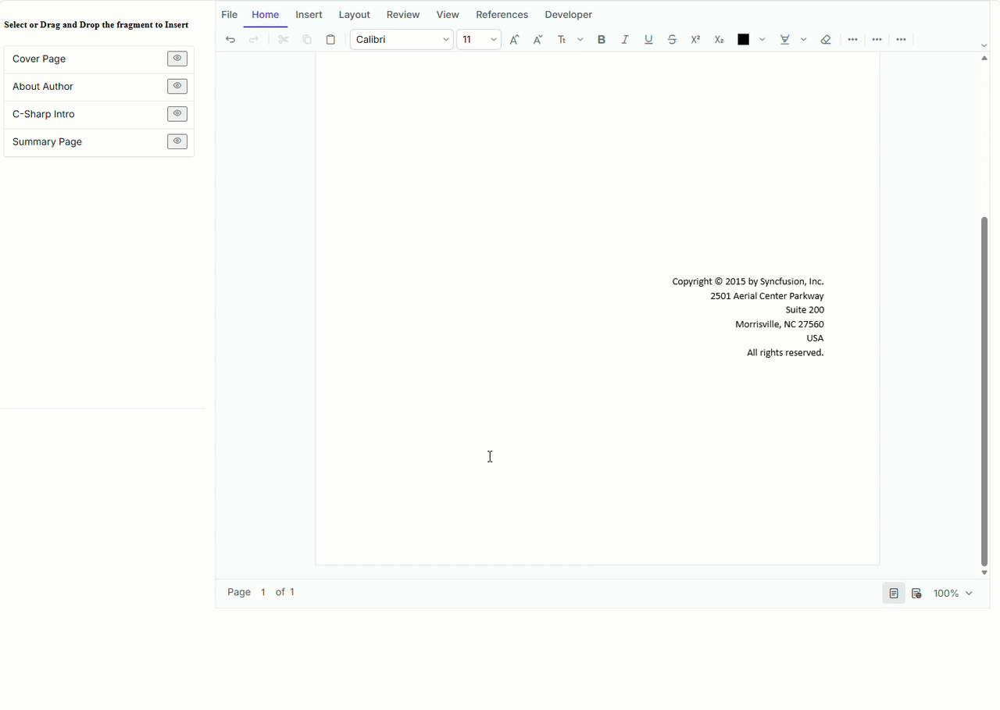

# React DOCX Editor – Drag and Drop Document Fragments

## Introduction

This repository contains a React example that demonstrates how to build reusable documents by dragging and dropping predefined document fragments into the Syncfusion<sup style="font-size:70%">&reg;</sup> [React DOCX Editor](https://www.syncfusion.com/docx-editor-sdk/react-docx-editor?utm_source=github&utm_medium=listing&utm_campaign=github-github-documenteditor-examples) (Document Editor).

The sample provides a collection of reusable SFDT document fragments that can be inserted into the editor either by:

- Selecting a fragment from the list.
- Dragging and dropping a fragment directly into the document.

When a fragment is dropped into the editor, the application determines the drop position, places the cursor at that location, and inserts the selected SFDT fragment using the **`editor.paste()`** API. This preserves the original formatting, styles, lists, tables, images, and other document elements contained in the fragment.

The sample also includes a read-only document preview dialog for viewing individual fragments before inserting them into the document.

---

## Features

- Drag and drop reusable document fragments
- Insert SFDT fragments using the `editor.paste()` API
- Preserve complete document formatting during insertion
- Insert content at the drop location
- Preview document fragments in a read-only dialog

---

# Prerequisites

Before running the sample, ensure the following software is installed:

- Node.js (LTS)
- npm

---

# How to Run the Application

## Clone the repository

```bash
git clone <repository-url>
cd react-docx-editor-drag-drop-fragments
```

---

## Install dependencies

Navigate to the project folder.

```bash
npm install
```

---

## Run the application

```bash
npm start
```

The application starts on the default React development server.

Example:

```
http://localhost:3000
```

---

# How It Works

The application contains a predefined collection of document fragments stored as SFDT objects.

Users can:

1. Select a fragment from the list.
2. Drag a fragment into the editor.
3. Drop the fragment at the required location.

During the drop operation, the application:

1. Detects the drop position.
2. Moves the editor selection to the cursor location.
3. Retrieves the corresponding SFDT fragment.
4. Inserts the fragment using the **`DocumentEditor.editor.paste()`** API.
5. Preserves all formatting and document structure of the inserted fragment.

Because the fragment is inserted as SFDT instead of plain text, complex content such as:

- Headings
- Tables
- Lists
- Images
- Paragraph formatting
- Character formatting
- Sections

---
## Demo

<p align="center">
  
</p>

# Project Workflow

```text
User

 │

 ▼

Select or Drag a Document Fragment

 │

 ▼

Retrieve Corresponding SFDT Fragment

 │

 ▼

Determine Drop Position

 │

 ▼

Move Cursor to Drop Location

 │

 ▼

DocumentEditor.editor.paste(fragment)

 │

 ▼

Fragment Inserted with Original Formatting
```

---

# Resources

- **Product page:**   [Syncfusion® React DOCX Editor](https://www.syncfusion.com/docx-editor-sdk/react-docx-editor?utm_source=github&utm_medium=listing&utm_campaign=github-github-documenteditor-examples) 

- **Documentation:**   [Syncfusion® React DOCX Editor - Documentation](https://help.syncfusion.com/document-processing/word/word-processor/react/overview?utm_source=github&utm_medium=listing&utm_campaign=github-github-documenteditor-examples) 

- **Online demo:**   [Syncfusion® React DOCX Editor - Online demo](https://document.syncfusion.com/demos/docx-editor/react/#/tailwind3/document-editor/default?utm_source=github&utm_medium=listing&utm_campaign=github-github-documenteditor-examples) 

# Support and feedback 

For any other queries, reach our [Syncfusion® support team](https://support.syncfusion.com/?utm_source=github&utm_medium=listing&utm_campaign=github-github-documenteditor-examples) or post the queries through the [community forums](https://www.syncfusion.com/forums?utm_source=github&utm_medium=listing&utm_campaign=github-github-documenteditor-examples). 

Request new feature through [Syncfusion® feedback portal](https://www.syncfusion.com/feedback?utm_source=github&utm_medium=listing&utm_campaign=github-github-documenteditor-examples). 

# License

This is a commercial product and requires a paid license for possession or use Syncfusion's licensed software, including this component, is subject to the terms and conditions of [Syncfusion's EULA](https://www.syncfusion.com/license/studio/34.1.29/syncfusion_essential_studio_eula.pdf?utm_source=github&utm_medium=listing&utm_campaign=github-github-documenteditor-examples). You can purchase a licnense [here](https://www.syncfusion.com/sales/products?utm_source=github&utm_medium=listing&utm_campaign=github-github-documenteditor-examples) or start a free 30\-day trial [here](https://www.syncfusion.com/account/manage-trials/start-trials?utm_source=github&utm_medium=listing&utm_campaign=github-github-documenteditor-examples). 